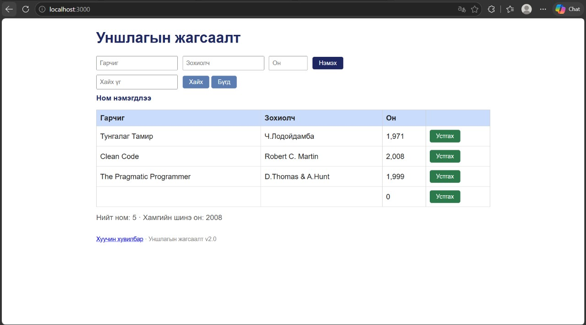

# BUG-02: Бүх талбар хоосон байхад «Нэмэx» дарахад ном нэмэгдэж «Ном нэмэгдлээ» гэж харагддаг

Орчин: Уншлагын жагсаалт v2.0, Microsoft Edge 155.0.4283.60 (Official build) (64-bit), Windows 11, 2026-10-17

Урьдчилсан нөхцөл: node app.js-ийг шинээр асаасан (анхны 3 ном)

## Дахин гаргах алхам

1. `node app.js`-ийг шинээр асааж http://localhost:3000 нээ.
2. Гарчиг, Зохиолч, Он талбарыг хоосон орхи.
3. «Нэмэx» товчийг дар.

Хүлээгдэж байсан: Спецификац: «Гарчиг, Зохиолч, Он гурван талбар бүгд заавал бөглөгдсөн байх ёстой; дутуу бол ном нэмэгдэхгүй, ойлгомжтой алдааны мессеж харагдана.»

Бодит үр дүн: Хүснэгтэд шинэ хоосон мөр нэмэгдэж, Он баганад `0` харагдана. Мессеж «Ном нэмэгдлээ». Алдааны мессеж байхгүй.

Ноцтой байдал: Major. Үндсэн шалгалт (заавал бөглөх) байхгүй тул хоосон бичлэг хуримтлагдана.

Хавсралт: 

Олдсон аялал: Couch Potato (хоосон оролт)
