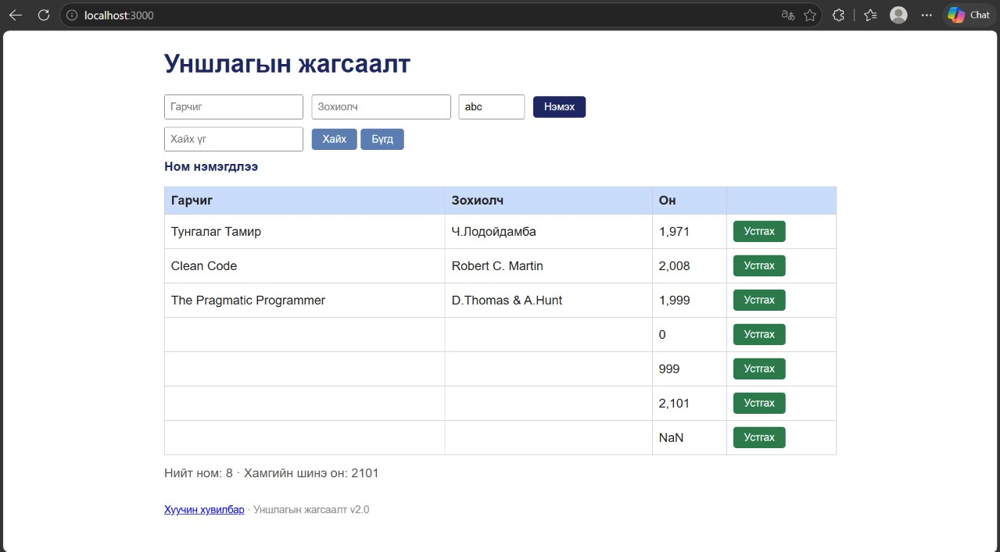

# BUG-05: Оны шалгалт байхгүй: 999, 2101, «abc» хүлээн авч, «abc» нь «NaN» болдог

Орчин: Уншлагын жагсаалт v2.0, Microsoft Edge 155.0.4283.60 (Official build) (64-bit), Windows 11, 2026-10-17

Урьдчилсан нөхцөл: node app.js-ийг шинээр асаасан (анхны 3 ном)

## Дахин гаргах алхам

1. `node app.js`-ийг шинээр асааж http://localhost:3000 нээ.
2. Гарчиг `Test`, Зохиолч `Tester`, Он `999` бич, «Нэмэx» дар.
3. Гарчиг `Test`, Зохиолч `Tester2`, Он `2101` бич, «Нэмэx» дар.
4. Гарчиг `Test`, Зохиолч `Tester3`, Он `abc` бич, «Нэмэx» дар.

Хүлээгдэж байсан: Спецификац: «Он нь 1000-2100 хоорондох бүхэл тоо.» Тэр хүрээнээс гадуурх болон тоо биш утга татгалзагдах ёстой.

Бодит үр дүн: Гурван мөр бүгд нэмэгдэнэ. Онууд нь `999`, `2,101`, `NaN` гэж харагдана. «Хамгийн шинэ он» нь `2101` болно.

Ноцтой байдал: Major. Буруу өгөгдөл хүлээн авч, «NaN» гэх мэт утгагүй утга харуулдаг.

Хавсралт: 

Олдсон аялал: Couch Potato (хязгаарын болон буруу утгууд)
