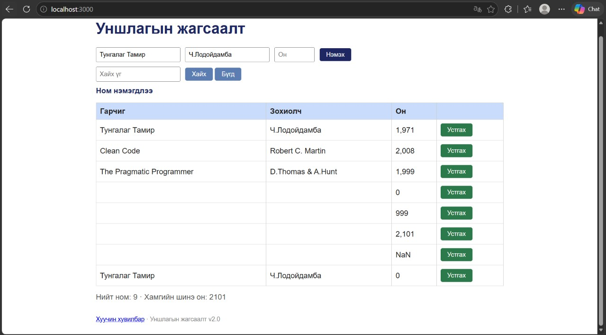

# BUG-06: Ижил гарчиг, зохиолчтой номыг давхардуулан нэмэх боломжтой

Орчин: Уншлагын жагсаалт v2.0, Microsoft Edge 155.0.4283.60 (Official build) (64-bit), Windows 11, 2026-10-17

Урьдчилсан нөхцөл: node app.js-ийг шинээр асаасан (анхны 3 ном)

## Дахин гаргах алхам

1. `node app.js`-ийг шинээр асааж http://localhost:3000 нээ.
2. Гарчиг `Тунгалаг Тамир`, Зохиолч `Ч.Лодойдамба`, Он `1971` бич, «Нэмэx» дар. Хүснэгтэд ижил ном аль хэдийн 1 удаа байгаа.
3. Хүснэгтийг хар.

Хүлээгдэж байсан: Спецификац: «Ижил гарчиг, зохиолчтой ном давхардуулж нэмэгдэхгүй.»

Бодит үр дүн: «Тунгалаг Тамир / Ч.Лодойдамба» мөр хоёр удаа харагдана, мессеж «Ном нэмэгдлээ».

Ноцтой байдал: Major. Өгөгдлийн бүрэн бүтэн байдал алдагдаж, жагсаалт давхардсан бичлэгээр дүүрнэ.

Хавсралт: 

Олдсон аялал: Couch Potato (давхардсан өгөгдөл)
